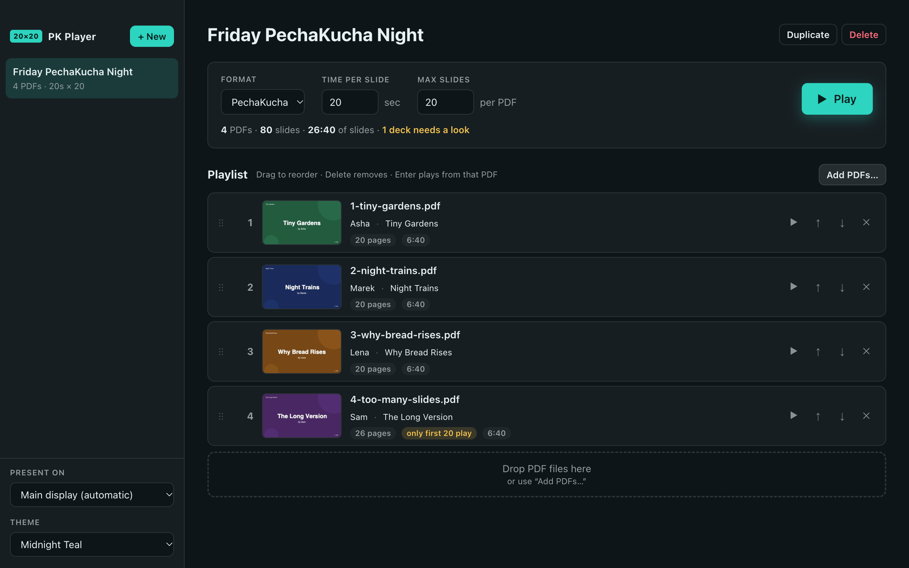
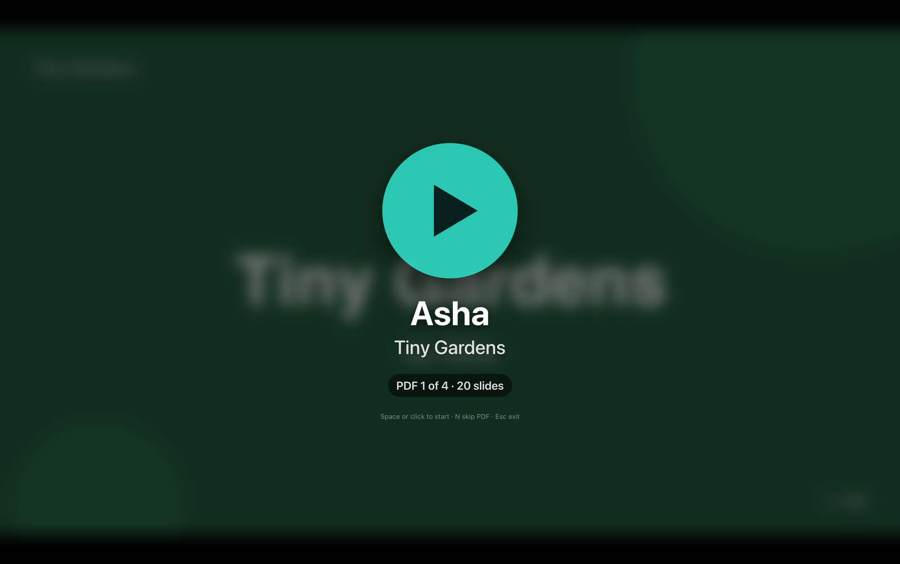

# PK Player

**Run a PechaKucha-style night straight from PDFs.** Drop every presenter's deck into one playlist and press Play. Each deck runs fullscreen at 20 seconds a slide, then stops on a big Play button until the next presenter is ready.

**[⬇ Download the latest version](https://github.com/vvaidy/pkplayer/releases/latest)** for Mac, Windows or Linux. It's free and open source. Read the no-warranty notice below before you use it.



> [!CAUTION]
> ## ⚠️ NO WARRANTY — USE ENTIRELY AT YOUR OWN RISK
> **PK PLAYER IS FREE SOFTWARE PROVIDED "AS IS", WITH NO WARRANTY OF ANY KIND, EXPRESS OR IMPLIED. THE AUTHOR ACCEPTS NO RESPONSIBILITY OR LIABILITY FOR ANYTHING THAT GOES WRONG WHEN YOU USE IT — INCLUDING A FAILED OR DISRUPTED EVENT, LOST OR DAMAGED FILES, OR ANY OTHER LOSS OR DAMAGE. BY USING PK PLAYER YOU ACCEPT ALL OF THE RISK.** See the [LICENSE](LICENSE) (MIT).

> [!WARNING]
> **Only tested on one Mac.** PK Player has been run and tested only on a Mac with Apple silicon (M4 Max) running macOS 26.6.2 (Tahoe). The Intel Mac, Windows and Linux versions are built automatically but have **never been run or tested**. They may not work at all.

## Why use it

- **One playlist for the whole night.** Presenters send a PDF. You drop the files in and drag them into order. There are no timings to set up inside each file.
- **Slides look the way the presenter made them.** A PDF carries its own fonts and layout, so nothing shifts on the event laptop.
- **Timing that doesn't drift.** Every slide gets exactly its time, measured at ±10 ms per slide.
- **A clean handover between presenters.** After a deck's last slide, the next deck waits on a Play button showing the presenter's name and talk title. Nothing advances until you press Space.
- **Problem decks are flagged before the night.** The playlist marks decks that are too long, too short, or a different shape from the others. Pages beyond Max slides are never shown.
- **Presenters can rehearse.** Practice a PDF plays a single deck with the real timer, without creating an event or saving anything.
- **Any timed format.** 20 slides × 20 seconds is the default. The **Format** menu switches to Ignite (20 slides × 15 seconds) in one click, or you can set anything from 1 second to an hour per slide.



## Get started

1. **Download** the file for your computer from the [latest release](https://github.com/vvaidy/pkplayer/releases/latest):

   | Computer | File |
   | --- | --- |
   | Mac with Apple silicon (M1 or later) | `PK-Player-<version>-mac-arm64.dmg` |
   | Mac with Intel processor | `PK-Player-<version>-mac-x64.dmg` |
   | Windows 10/11 (64-bit) | `PK-Player-<version>-win-x64.exe` |
   | Linux (64-bit) | `PK-Player-<version>-linux-x86_64.AppImage` |

2. **Install it.** [Installing PK Player](docs/manual/06-installing.md) covers each system and the first-launch prompt.
3. **Run your first event** with the [five-minute tutorial](docs/manual/01-getting-started.md).

Then, when you need them:

- [Running a live night](docs/manual/02-running-a-live-night.md), for a real event with a projector and an audience
- [Preparing decks](docs/manual/05-preparing-decks.md), to send to your presenters
- [Troubleshooting & FAQ](docs/manual/07-troubleshooting.md)
- **📖 [The full manual](docs/manual/README.md)**, also in the app's Help menu

## Editor

- **+ New** creates an Event (defaults: 20 s per slide, 20 max slides). **Format** sets both at once: PechaKucha (20 × 20 s), Ignite (20 × 15 s) or Custom.
- Drop PDFs onto the playlist (at the drop position), onto an event in the sidebar, or anywhere in the window. With no event selected, dropping creates a new one. You can also use **Add PDFs…** (⌘O).
- PDFs are copied into the app's library, so moving or deleting the originals is safe (File → Reveal Library Folder).
- Each row has optional **Presenter** and **Talk title** fields, shown on that deck's Play screen. They are pre-filled from the PDF's Title and Author properties when those look real.
- To reorder, drag rows, use the ↑/↓ buttons, or press ⌥↑/⌥↓ on a focused row. To remove a row, use ✕ or press Delete.
- Rows show page count, that deck's run time, and warnings: more pages than Max Slides, fewer pages (PechaKucha and Ignite formats only), or a page shape that differs from most other decks. The summary counts the decks that need a look.
- **Present on** chooses which display goes fullscreen.
- **Theme** picks from 11 color themes, dark and light, all made for PK Player. It colors the editor and the player's own controls, never your slides. "Vibe with Claude" is the original look. **Customize…** makes your own theme from six colors with a live preview; **Import…** reads a PK Player, Ghostty or iTerm2 theme file.
- Play options: **Play** (or **F**), ▶ on a row to start from that PDF, or Enter on a focused row.
- **File → Practice a PDF…** (⇧⌘P) plays one PDF with the timer and saves nothing. It uses the selected event's timing, or 20 × 20 when no event is selected.

## Player keys

| Key | Action |
| --- | --- |
| Space / Enter / click | Start the deck from the big Play button |
| Space | Pause / resume |
| → / ← | Next / previous slide (restarts that slide's timer) |
| N | Skip to the next PDF (waits on its Play button) |
| Esc, X, Delete | Stop and return to the editor |
| F | Re-enter fullscreen |

Each deck plays `min(pages, Max Slides)` slides and then stops on the next deck's Play button. Pages beyond Max Slides are skipped. After the last deck it shows "End of event". If you stop mid-event, the editor offers **Play from #N** to restart at that PDF. Timing is deadline-based, so it doesn't drift; measured at ±10 ms per slide. Display sleep is blocked while the player is open.

## Building from source

- Installers: `npm run dist` (Mac), `npm run dist:win`, `npm run dist:linux` → `dist/PK-Player-<version>-<os>-<arch>.<ext>`, or let GitHub Actions build all three (see [Building & releasing](docs/manual/08-building-and-releasing.md)). Mac release builds are signed and notarized, in CI or locally with `npm run dist:mac:signed`; Windows and Linux builds are unsigned. See [first-launch warnings](docs/manual/06-installing.md#first-launch-warnings).
- From source: `npm install`, then `npm start`.

## Development

```bash
npm test                 # unit tests (headless)
npm run test:e2e         # Electron end-to-end tests — OPENS FULLSCREEN WINDOWS on your displays
npm run fixtures         # regenerate samples/ test PDFs
npm run dist             # build Mac DMG + zip into dist/ (dist:win, dist:linux also work from a Mac)
npm run dist:mac:signed  # same, signed + notarized by Apple (needs the Developer ID setup; see Building & releasing)
node scripts/make-demo-decks.js          # regenerate samples/demo/ tutorial decks
node scripts/capture-docs-screens.js     # regenerate manual screenshots — OPENS FULLSCREEN WINDOWS
PK_DOCS_EDITOR_ONLY=1 node scripts/capture-docs-screens.js   # editor screenshots only: one normal window, nothing fullscreen
```

To run the e2e suite against the packaged app, set `PK_E2E_EXECUTABLE="dist/mac-arm64/PK Player.app/Contents/MacOS/PK Player"`.
Debug logging: `PKPLAY_DEBUG=1 npm start`. Use `PKPLAY_DATA_DIR=/some/dir` for an isolated data folder.

Layout: `main.js` (main process, `app://` protocol, IPC), `preload.cjs` (bridge), `src/main/store.js` (persistence), `src/lib/player-controller.js` (pure timing state machine), `src/renderer/` (editor + player UI, pdf.js).

## License

MIT. See [LICENSE](LICENSE). **No warranty: you use PK Player entirely at your own risk.**

PK Player is an independent project. It is not affiliated with or endorsed by the PechaKucha organization, and "PechaKucha" is a trademark of its owner.
