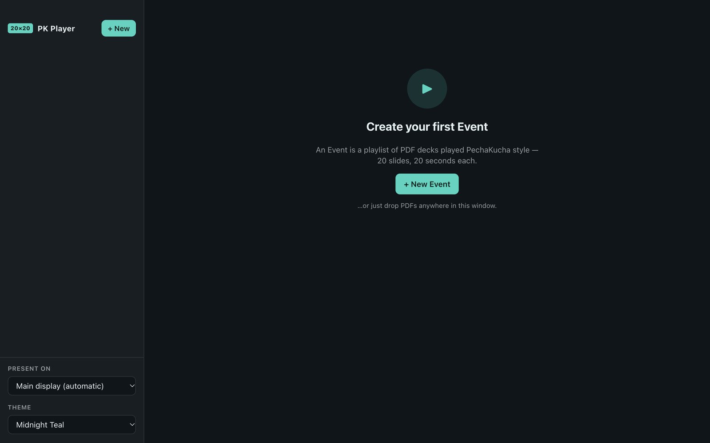
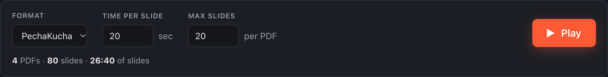
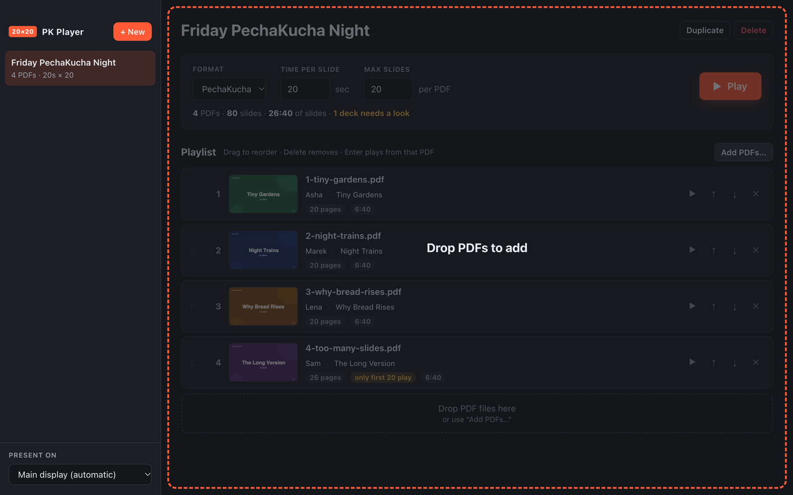
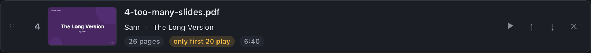
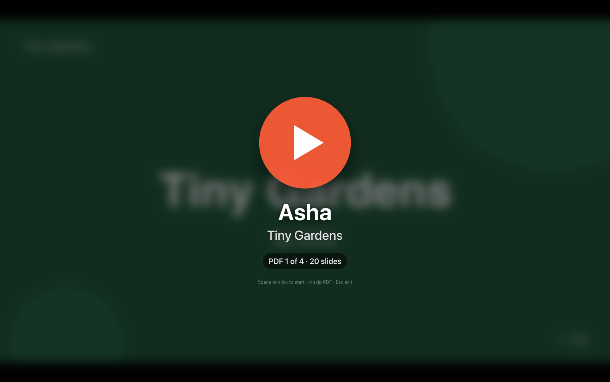
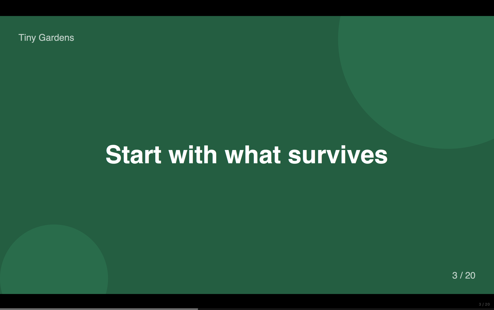
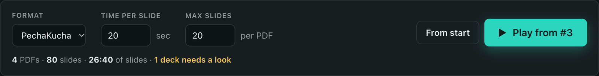

# Tutorial 1 — Your first event

Time: about five minutes. You'll build an event from the demo decks that ship with PK Player, run it, and learn the controls you'll use on the night.

> **Demo decks.** The source repository has four sample PDFs in `samples/demo/`. If you only have the installed app, use any PDFs you like — exported slide decks work best.

## 1. Open PK Player

The first time, you'll see an empty window:

If macOS or Windows asks before opening the app the first time, see [First-launch warnings](06-installing.md#first-launch-warnings). The Mac version is signed by Apple and opens after one click; the Windows version is unsigned and needs **More info** → **Run anyway** once.

## 2. Create an event

Click **+ New Event** (or press ⌘N / Ctrl+N). A new event appears in the sidebar and its name is ready to edit at the top. Type a name — say *Friday PechaKucha Night* — and press Enter.

Two settings sit under the name, next to a **Format** menu that fills them in for you (PechaKucha, Ignite, or Custom):

- **Time per slide** — seconds each slide is on screen. PechaKucha is 20.
- **Max slides** — the most pages any single PDF may show. PechaKucha is 20.

Leave both at 20. The line underneath adds things up for you: number of PDFs, total slides that will play, and total slide time.

## 3. Add the decks

Drag PDF files from Finder / Explorer and drop them anywhere in the window. While you drag, the window shows where they'll go:

Or click **Add PDFs…** (⌘O / Ctrl+O) and pick files. Add all four demo decks.

Each PDF becomes a row in the **Playlist** with a thumbnail of its first page, its page count and how long it will run. The demo decks also arrive with a **Presenter** and **Talk title** already filled in, read from the PDFs; you can edit or empty these two fields, and they are optional. PK Player copies every PDF into its own library, so you can move or delete the originals afterwards.

Notice the fourth row:

`4-too-many-slides.pdf` has 26 pages. The yellow **only first 20 play** badge tells you pages 21–26 will be skipped. That is PechaKucha's rule, enforced: a presenter can't sneak in extra slides.

## 4. Put them in order

Presenters go in playlist order. To change it:

- drag a row by its handle (⋮⋮) and drop it where you want it, or
- use the ↑ / ↓ buttons on the row, or
- click a row and press ⌥↑ / ⌥↓ (Alt+↑ / Alt+↓ on Windows and Linux).

To remove a row, click its ✕ or select it and press Delete.

## 5. Play

Click **Play** (or press **F**). The player goes fullscreen and waits:

The label under the button tells you which deck is up — handy for the MC. Nothing happens until you press **Space** (or Enter, or click the button).

Press **Space**. The first slide is now live. A thin, translucent progress bar along the bottom fills over the 20 seconds; a faint counter in the corner shows `1 / 20`:

Let a couple of slides advance on their own. Then try the controls:

| Try | What happens |
| --- | --- |
| **Space** | Pauses. A pause badge appears top-right; the timer freezes. Space again resumes where it left off. |
| **→** | Jumps to the next slide and gives it a fresh 20 seconds. |
| **←** | Goes back a slide, also with a fresh 20 seconds. |
| **N** | Abandons this deck and puts the next one on its Play button. |
| **Esc** | Stops and takes you back to the editor. |

When a deck finishes, the next one waits on its Play button — that's the gap for applause and the next presenter walking up. After the last deck you'll see **End of event**.

## 6. Stop and resume

Press **Esc** in the middle of the second deck. Back in the editor, the Play button now says **Play from #2**, with **From start** next to it:

**Play from #N** reopens the player on that presenter's deck (from its first slide). **From start** starts over from deck 1. You can also start from any deck by clicking ▶ on its row, or selecting the row and pressing Enter.

## You're done

That's the whole workflow. Before a real event, read [Tutorial 2 — Running a live night](02-running-a-live-night.md) for projector setup and what to do when things go sideways.
