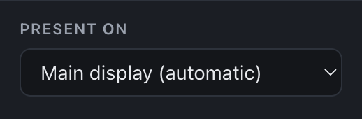

# Tutorial 2 — Running a live night

This walks through a real event: collecting decks, setting up at the venue, running the show, and recovering from the usual mishaps.

## A week before: collect decks

1. Send presenters the [Preparing decks](05-preparing-decks.md) page. The essentials: **a PDF, 16:9, exactly 20 slides, no animations or video.**
2. As decks arrive, drop them into your event. Check each row:
   - the page count — a yellow **only first 20 play** badge means the deck is too long and its last pages will never show. Tell the presenter now, not at the venue.
   - **only 17 slides** — the deck is short and will end early.
   - **4:3, most are 16:9** — this deck is a different shape from the others and will show black bars.
   - the thumbnail — a red **Unreadable PDF** means the file is broken; ask for a re-export.

   The summary line under the settings counts the flagged decks (**2 decks need a look**), so one glance tells you whether anything is outstanding.
3. Order the playlist in running order. If you'll have an intermission, consider two events (*Night — Part 1*, *Night — Part 2*); **Duplicate** copies an event with its playlist, which is a quick way to split one.

PDFs are copied into PK Player's library when you add them, so a presenter sending a fixed version means: remove the old row, add the new file.

## At the venue: set up the display

1. Connect the projector or screen **before** opening the player.
2. Set displays to **extend**, not mirror (macOS: System Settings → Displays; Windows: Win+P → Extend). With mirroring there is only one display and you lose your editor screen.
3. In the PK Player sidebar, choose the projector under **Present on**:

   

   The list shows each connected display by name and resolution. *Main display (automatic)* means "whichever display is primary". If the chosen display is unplugged later, PK Player falls back to the main display.
4. Press **Play**, check the first slide fills the projector, then **Esc** back to the editor. Your choice of display is remembered.

PK Player keeps the screen from sleeping while the player is open. Still, plug the laptop into power.

## Do a dry run

With the real playlist, do a fast run-through:

- Play, press **Space**, tap **→** a few times to see slides render properly, then **N** to the next deck. Repeat through the whole playlist. This catches unreadable PDFs and odd aspect ratios before the audience does.
- Click **From start** when you're done so the night starts from deck 1.

## Showtime

1. Select the event and press **Play** (or **F**). The projector shows the first deck on its Play button with the presenter's file name underneath — useful for the MC's introduction.
2. When the presenter is ready, press **Space**. From here, you don't touch anything: slides advance every 20 seconds and the deck ends on its own.
3. The next deck appears on its Play button and waits. Applause, the next presenter walks up, you press **Space**.
4. After the last deck: **End of event**. Press **Esc**.

The operator only ever needs one key: **Space**.

## When things go wrong

| Situation | What to do |
| --- | --- |
| Presenter needs a moment mid-talk (mic died, slide question) | **Space** pauses. **Space** again resumes with the remaining time on that slide. |
| A slide advanced too early because someone bumped a key | **←** goes back; that slide gets a fresh full timer. |
| Presenter is a no-show or wants to go later | On their Play button, press **N** to skip to the next deck. To bring them back later, **Esc**, drag their row to the right place, and press ▶ on that row. |
| You pressed **Esc** by accident mid-deck | Press **Play from #N** in the editor. It restarts that presenter's deck from slide 1; press **→** to get back to where they were. |
| Player opened on the laptop screen instead of the projector | **Esc**, pick the projector in **Present on**, **Play from #N**. |
| Player is no longer fullscreen (someone clicked the green button) | Press **F**. |
| A deck shows the wrong file | **Esc**, fix the playlist (remove/add), **Play from #N**. |

## After the event

Your event stays in the sidebar with all its PDFs — useful for a "best of" night. To free disk space, delete the event; PDFs no longer used by any event are removed from the library automatically.
