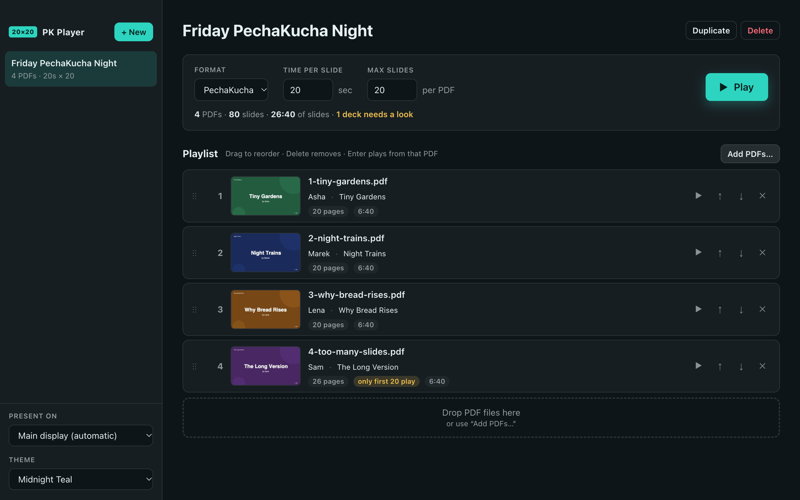
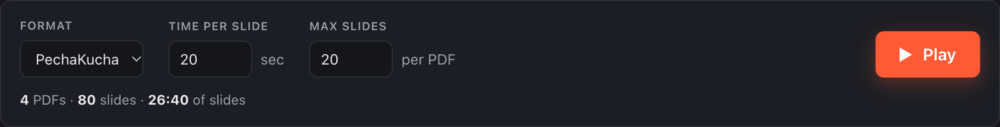
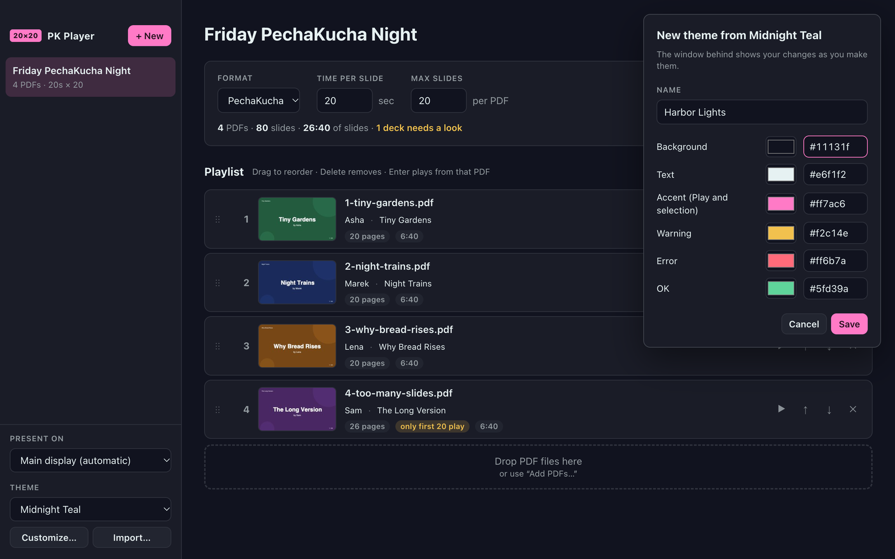

# The editor

The editor is the window you see when PK Player opens. Left: your events and the display picker. Right: the selected event.

## Events

An **Event** has a name, two settings (with a Format shortcut for them), and a playlist of PDFs. Events are saved automatically as you edit — there is no Save button.

| Action | How |
| --- | --- |
| Create | **+ New** in the sidebar, **+ New Event** on the empty screen, File → New Event, or ⌘N / Ctrl+N. Dropping PDFs when no event is selected also creates one. |
| Rename | Click the name at the top and type. Enter or Esc finishes. |
| Switch | Click an event in the sidebar. Each one shows its PDF count and settings, e.g. `4 PDFs · 20s × 20`. |
| Duplicate | **Duplicate** (top right). Copies settings and playlist; the copy is named "… copy". PDFs are shared, not copied again. |
| Delete | **Delete** (top right), then confirm. PDFs used by no other event are removed from the library. |

## Settings

| Setting | Default | Allowed | Meaning |
| --- | --- | --- | --- |
| Time per slide | 20 sec | 1–3600 | How long each slide stays on screen. |
| Max slides | 20 per PDF | 1–999 | The most pages any PDF in this event may show. Later pages are skipped. |

Change a value and press Enter or click elsewhere. An out-of-range value shakes, shows an error and reverts.

**Format** sets both values in one step:

| Format | Time per slide | Max slides |
| --- | --- | --- |
| PechaKucha | 20 sec | 20 |
| Ignite | 15 sec | 20 |
| Custom | whatever you type | whatever you type |

Format always shows what the two settings currently are. If you change either setting by hand to something that matches no format, it switches to **Custom**. Choosing Custom yourself changes nothing; it puts the cursor in Time per slide so you can type.

Under the settings, the summary shows **PDFs · slides that will actually play · total slide time**, plus a yellow count of decks that need a look (see [Playlist](#playlist)). The total excludes the pauses on each Play button, so allow a little more on the night.

## Playlist

Each row shows, from left: drag handle, position, first-page thumbnail, file name, two optional text fields, and badges.

### Presenter and talk title

Under the file name each row has two fields, **Presenter** and **Talk title**. Both are optional. When either is filled in, the player shows it in large type on that deck's Play screen, in place of the file name.

- Click a field and type. **Enter** or clicking elsewhere saves; **Esc** puts back what was there.
- Empty a field to remove it. Leave both empty and the Play screen shows the file name, as before.
- When you add a PDF, PK Player fills these in from the PDF's own Title and Author properties if they look like real ones. Placeholders such as "PowerPoint Presentation" or "Microsoft Office User", account-style names such as `jsmith42`, and titles that just repeat the file name are ignored. **Check what was filled in**: it comes from the presenter's software, and it will be on the big screen.
- Defaults are only applied when a PDF is added. Clearing or changing a field is never undone later.

### Badges

| Badge | Meaning |
| --- | --- |
| `20 pages` | Pages in the PDF. |
| `only first 20 play` (yellow) | The PDF has more pages than Max slides; the rest are skipped. |
| `only 17 slides` (yellow) | The PDF has fewer pages than Max slides, so this deck will end early. Shown only when Format is PechaKucha or Ignite. Under Custom, Max slides is just an upper limit and short decks are normal. |
| `4:3, most are 16:9` (yellow) | The page shape differs from most other decks in this event, so this deck will show black bars that the others don't. |
| `6:40` | How long this deck will run. |
| `Cannot read this PDF — it will be skipped` (red) | The file is damaged or not really a PDF. The player skips it. |

When any row has a yellow or red badge, the summary under the settings adds a count in yellow, e.g. **2 decks need a look**. Nothing is blocked: you can still play the event.

The shape check looks at the first page of each PDF and compares decks with each other, not with your display. It only speaks up when one shape is clearly the most common: with one 16:9 deck and one 4:3 deck, neither is flagged.

Row buttons (they brighten when you hover): **▶** play from this PDF, **↑ / ↓** move, **✕** remove.

### Adding PDFs

- Drop files on the playlist — they're inserted where you drop them (a glowing line shows the spot).
- Drop files anywhere else in the window — they're added at the end.
- Drop files on an event in the sidebar — they're added to that event.
- **Add PDFs…** or ⌘O / Ctrl+O opens a file picker.

You can add many files at once. Files that aren't PDFs are rejected with a message naming each one. PK Player checks the file's contents, not just its extension.

Added PDFs are **copied** into PK Player's library, so the originals can be moved, renamed or deleted. File → **Reveal Library Folder** shows the copies.

### Reordering and removing

- Drag a row to a new position.
- Use the row's ↑ / ↓ buttons.
- Keyboard: click a row, then ↑ / ↓ moves the focus, ⌥↑ / ⌥↓ (Alt+↑ / Alt+↓) moves the PDF, Delete or Backspace removes it, Enter plays from it.

## Playing

| Control | Starts |
| --- | --- |
| **Play** button or **F** | From deck 1 — or, after you stopped mid-event, from the deck you stopped on. |
| **Play from #N** | Shown after stopping mid-event: restarts at deck N, slide 1. |
| **From start** | Shown next to **Play from #N**: always deck 1. |
| Row **▶** or Enter on a row | From that deck. |

The resume point is kept until you quit the app.

## Speedrun test

**Speedrun test…** (above the playlist, and in the File menu) plays every slide of every deck in the event fast, fullscreen on the display you chose, so you can see that everything loads and displays before the night.

- A dialog asks first. Choose **5×**, **10×** or **20×** and click **Start test**. It shows how long each choice will take. Cancel is the default button.
- Each deck's Play screen shows for a second, then the deck starts by itself. You don't press anything.
- A yellow **SPEED TEST 10× — not a real run** bar stays across the top of the screen the whole time.
- Each slide is given its time only once it has finished drawing, so a slow or broken page can't slip past.
- At the end a report says **Speedrun passed**, or lists what went wrong: a PDF that could not be opened, a slide that could not be drawn, or a slide that took more than 10 seconds.
- **Space** pauses so you can look at a slide, the arrow keys and **N** skip, and **Esc** stops. Skipping means the report will say some slides were not shown.

**It cannot be left on.** The speed belongs to that one test run. It is never saved, the dialog always opens on 10×, there is no keyboard shortcut, and there is no slower-than-normal choice. **Play**, **F**, Enter and the row **▶** buttons always run at normal speed. A speedrun also leaves the event's resume point alone.

## Practice a PDF

**File → Practice a PDF…** (⇧⌘P / Ctrl+Shift+P) plays a single PDF with the timer, without creating an event. It is meant for a presenter rehearsing their own talk. The first screen of a fresh install has a **Practice a PDF…** button too.

- Pick a PDF. The player opens on its Play button, exactly as it would on the night, and all the [player keys](04-player.md#keys) work.
- **Timing:** if an event is selected, practice uses that event's Time per slide and Max slides. With no event selected it uses 20 seconds and 20 slides.
- **Nothing is saved.** No event is created, nothing is added to your playlists, and PK Player's working copy of the PDF is removed when you press Esc. Your own file is never changed.
- To rehearse again, choose Practice a PDF… again.

## Present on

The **Present on** menu at the bottom of the sidebar chooses which display the player fills. It lists every connected display with its name and resolution, and updates when you plug or unplug one. The choice is saved; if that display is missing at play time, the main display is used.

## Theme

The **Theme** menu under Present on changes PK Player's colors. The choice is saved and applies to the editor and to the player's own controls: the Play button, its glow, and anything else PK Player draws. Your slides are never tinted.

| Dark | Light |
| --- | --- |
| Midnight Teal (the default) | Paper |
| Blueprint | Sage |
| Aubergine | Blossom |
| Forest | |
| Lagoon | |
| Graphite | |
| Projector (high contrast) | |
| Vibe with Claude | |

- **Vibe with Claude** is the original look of PK Player up to version 1.0.2, kept exactly.
- **Projector** is black and white with one bright accent, for washed-out projectors and bright rooms.
- Every theme was made for PK Player. None is taken from another project's color scheme.
- The yellow and red badges described above use each theme's own warning and error colors, so their exact shade varies.

### Your own themes

**Customize…** under the Theme menu opens the theme editor. The window behind it repaints as you change things, so you see the real result before saving.

- A theme is a name and six colors: **Background**, **Text**, **Accent** (the Play button and the selection), **Warning**, **Error** and **OK**. PK Player works out every other shade (cards, borders, dim text, hover states) from those six.
- For each color, click the swatch to use your system's color picker, or type a value such as `#2dd4bf`.
- Whether the theme is dark or light follows the background color. There is no separate switch.
- If a color would be hard to read (pale text on a pale background, say), PK Player shows it slightly adjusted and a line in the editor tells you which colors were adjusted. Your own values are what gets saved.
- **Save** keeps the theme and switches to it. **Cancel** or **Esc** puts the previous colors back.

Built-in themes are never changed. Customizing one starts a copy ("Midnight Teal copy") that is saved under **Your themes** at the bottom of the Theme menu. Customizing one of your own themes edits it in place, and the editor then also offers:

- **Delete** removes the theme after asking. If it was in use, PK Player goes back to Midnight Teal.
- **Export…** writes the saved theme to a small `.pkplayer-theme.json` file you can share or keep as a backup.

You can keep up to 100 themes of your own. They are stored with your events (see [Where your data lives](06-installing.md#where-your-data-lives)).

### Importing a theme

**Import…** adds a theme from a file and switches to it. Three kinds of file work:

| File | Where it comes from |
| --- | --- |
| `.pkplayer-theme.json` | **Export…** in PK Player |
| A Ghostty theme file | The Ghostty terminal's `themes` folder, or one you wrote |
| `.itermcolors` | iTerm2's color presets |

From a terminal color scheme PK Player takes the background and text colors, and uses the scheme's blue for the accent, yellow for warnings, red for errors and green for OK. Use **Customize…** afterwards if you would like a different accent.

PK Player does not include any terminal color schemes itself. Importing reads a file that you provide, and the result is stored only on your computer.

