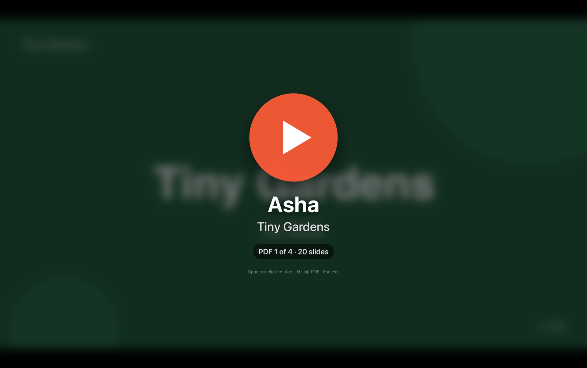
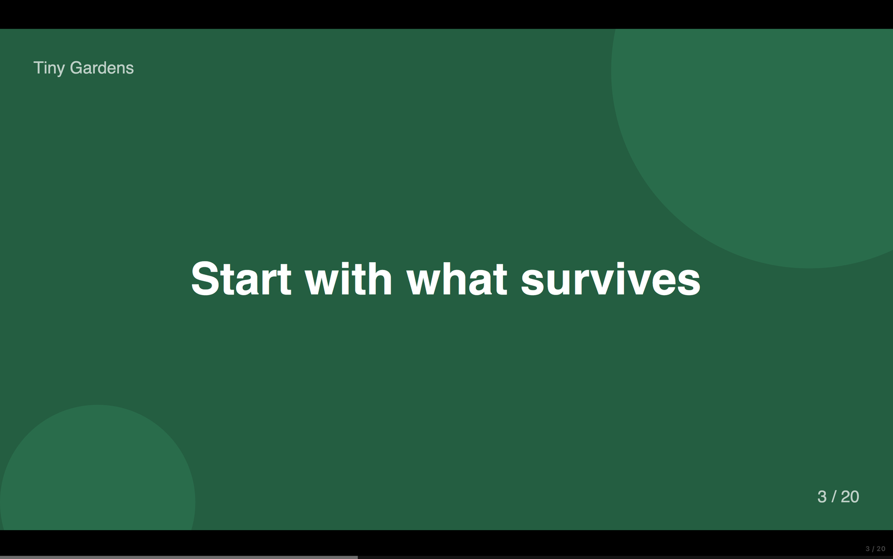
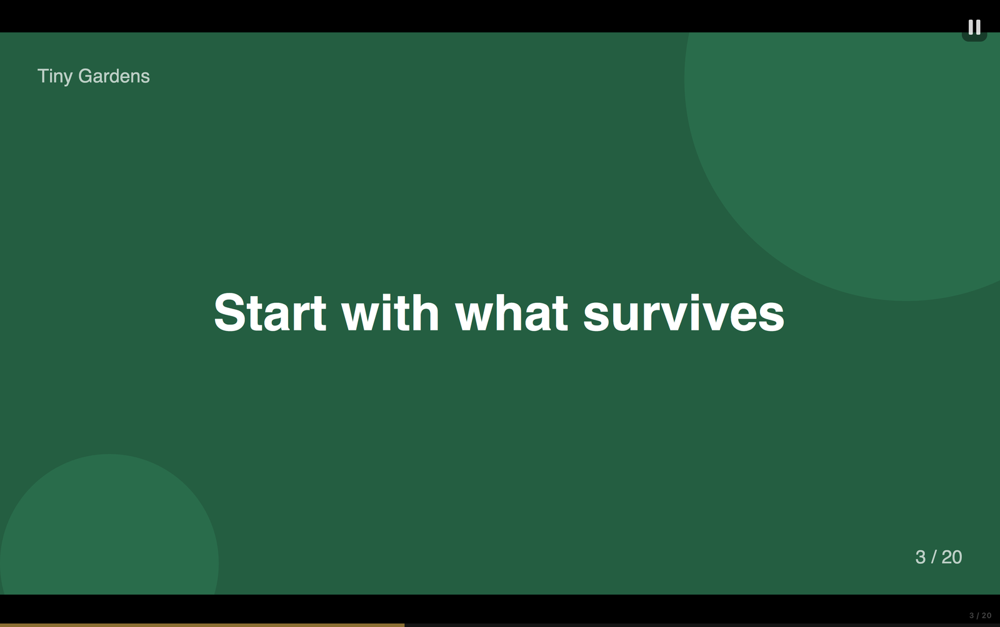
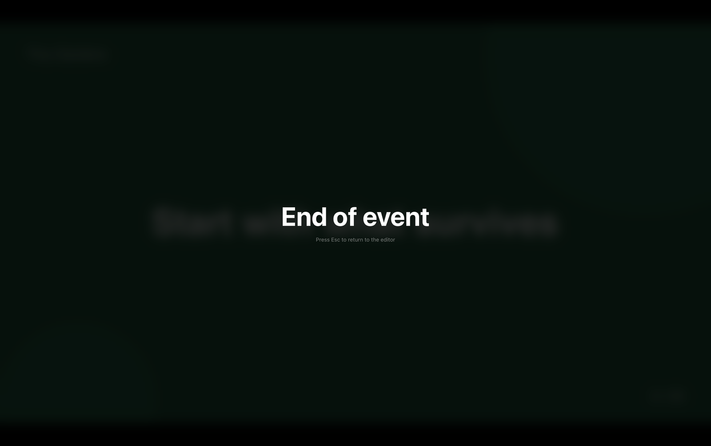

# The player

The player is the fullscreen window your audience sees. It opens on the display chosen in **Present on**, blocks the screen saver and display sleep while open, and hides the mouse pointer after two seconds without movement.

## Screens

### Waiting on Play

Shown before every deck. The deck's first slide is blurred behind a large Play button; the label shows *PDF n of total · file name · slides that will play*. If the deck has a [presenter or talk title](03-editor.md#presenter-and-talk-title), those appear in large type above the label and the file name is left out. Time does not run here. Start with **Space**, **Enter**, or a click on the button.

### Playing

The slide fills the screen, letterboxed in black if its shape doesn't match the display. Two discreet indicators:

- **Progress bar** — a thin translucent bar along the bottom edge that fills over the slide's time and resets each slide.
- **Counter** — a faint `3 / 20` in the bottom-right corner: slide number of slides that will play in this deck.

After the deck's last playable slide (Max slides, or the last page if fewer), the next deck appears on its Play button.

### Paused

A pulsing pause badge appears top-right and the progress bar stops. Resuming continues with the time that was left on the slide.

### End of event

Shown after the last deck. Press **Esc** to return to the editor.

## Keys

| Key | Waiting on Play | Playing / Paused |
| --- | --- | --- |
| Space | Start the deck | Pause / resume |
| Enter or click | Start the deck | — |
| → | — | Next slide, with a fresh timer. Past the last slide goes to the next deck's Play button. |
| ← | — | Previous slide, with a fresh timer. |
| N | Skip this deck | Abandon this deck; next deck waits on Play. On the last deck: End of event. |
| Esc, X, Delete, Backspace | Stop, back to editor | Stop, back to editor |
| F | Re-enter fullscreen | Re-enter fullscreen |

Arrow keys work while paused too; you stay paused on the new slide.

A small message flashes in the middle of the screen to confirm Pause, Resume and Next PDF.

## Timing

Each slide gets exactly **Time per slide**. The player schedules every slide change from the moment Play was pressed instead of counting from the previous change, so small delays can't accumulate. In testing, changes land within about 10 ms of their target across a whole deck. The next slide is rendered in advance, so changes are instant even for heavy PDFs.

## Stopping

Stopping (Esc, X, Delete) leaves fullscreen, closes the player and brings the editor back. If you stopped mid-event, the editor offers **Play from #N** for the deck you were on.

## Unreadable PDFs

If a PDF can't be opened when the player starts, it is skipped and a message says how many were skipped. The rest of the event plays normally.
