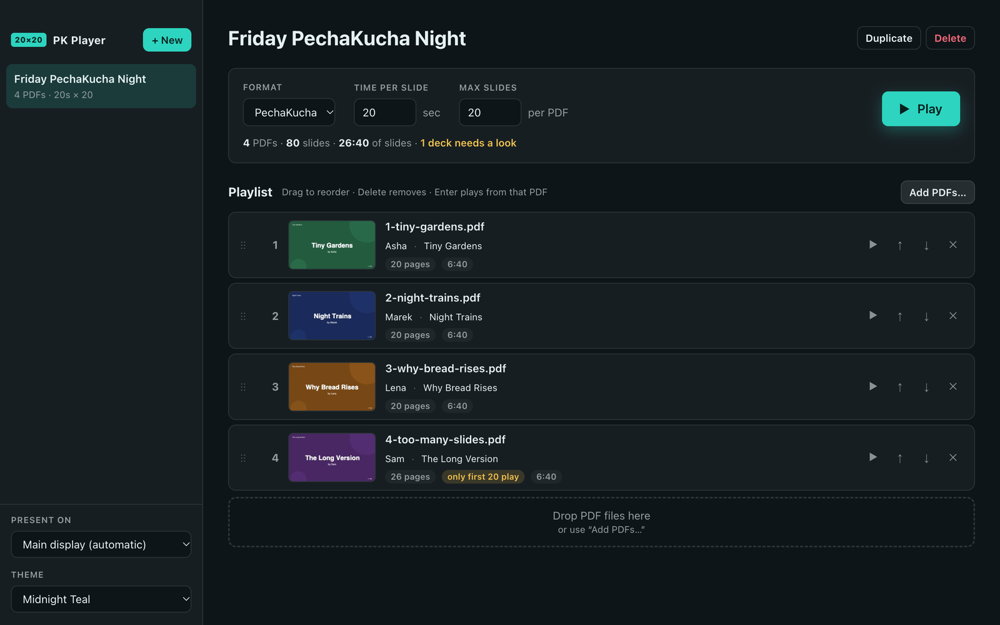

# PK Player Manual

PK Player runs PechaKucha nights from PDF files. You build an **Event** — a playlist of presenters' decks — and PK Player shows each deck fullscreen, advancing every slide on a fixed timer, and stopping on a big Play button between presenters.

> [!CAUTION]
> ## ⚠️ NO WARRANTY — USE ENTIRELY AT YOUR OWN RISK
> **PK PLAYER IS FREE SOFTWARE PROVIDED "AS IS", WITH NO WARRANTY OF ANY KIND, EXPRESS OR IMPLIED. THE AUTHOR ACCEPTS NO RESPONSIBILITY OR LIABILITY FOR ANYTHING THAT GOES WRONG WHEN YOU USE IT — INCLUDING A FAILED OR DISRUPTED EVENT, LOST OR DAMAGED FILES, OR ANY OTHER LOSS OR DAMAGE. BY USING PK PLAYER YOU ACCEPT ALL OF THE RISK.** See the [LICENSE](../../LICENSE) (MIT).

> [!WARNING]
> **Only tested on one Mac.** PK Player has been run and tested only on a Mac with Apple silicon (M4 Max) running macOS 26.6.2 (Tahoe). The Intel Mac, Windows and Linux versions are built automatically but have **never been run or tested**. They may not work at all.

## Start here

| If you want to… | Read |
| --- | --- |
| Install the app | [Installing PK Player](06-installing.md) |
| Run your first event in five minutes | [Tutorial 1 — Your first event](01-getting-started.md) |
| Prepare for a real night with a projector and an audience | [Tutorial 2 — Running a live night](02-running-a-live-night.md) |
| Tell presenters how to make their PDFs | [Preparing decks](05-preparing-decks.md) |

## Reference

- [The editor](03-editor.md) — events, settings, playlists, drag and drop
- [The player](04-player.md) — screens, timing, every key
- [Troubleshooting & FAQ](07-troubleshooting.md)
- [Building & releasing](08-building-and-releasing.md) — for whoever maintains the app

## Cheat sheet

**In the player**

| Key | Does |
| --- | --- |
| Space / Enter / click | Start the deck waiting on the Play button |
| Space | Pause / resume |
| → / ← | Next / previous slide (restarts that slide's timer) |
| N | Skip to the next PDF (it waits on its Play button) |
| Esc, X, Delete | Stop and return to the editor |
| F | Go back to fullscreen |

**In the editor**

| Key | Does |
| --- | --- |
| F | Play the selected event |
| ⌘N / Ctrl+N | New event |
| ⌘O / Ctrl+O | Add PDFs |
| ↑ / ↓ | Move between playlist rows |
| ⌥↑ / ⌥↓ (Alt on Windows/Linux) | Move the focused PDF up / down |
| Delete / Backspace | Remove the focused PDF |
| Enter | Play starting from the focused PDF |

## The rules PK Player enforces

- Every slide is shown for exactly **Time per slide** (default 20 s). Timing is deadline-based, so it does not drift over a deck.
- Each PDF plays at most **Max slides** pages (default 20). Extra pages are skipped, never shown.
- After a deck's last slide, the next deck appears and **waits on its Play button** — nothing advances until someone presses Space.
- After the last deck, the screen says **End of event**.
